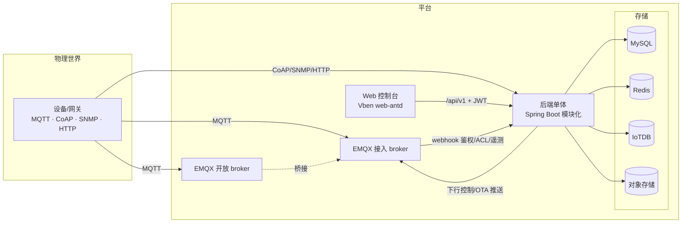

# 00 · 总览与技术选型

> Materin（格物）IoT 平台架构设计 · 索引页
>
> | 章节 | 文件 | 内容 |
> |---|---|---|
> | 01 | [product-design.md](01-product-design.md) | 产品设计：定位/用户/能力全景/功能地图/页面地图 |
> | 02 | [backend.md](02-backend.md) | 后端架构：模块划分/依赖/SPI/关键约束 |
> | 03 | [frontend.md](03-frontend.md) | 前端架构：Vben 精简/路由/状态/API 层 |
> | 04 | [data.md](04-data.md) | 数据架构：四类数据的归属与流转 |
> | 05 | [deployment.md](05-deployment.md) | 部署架构：拓扑/网络/环境/扩缩容 |
> | 06 | [flows.md](06-flows.md) | 关键场景时序：遥测/OTA/文件/告警 |

## 1. 一图总览

## 2. 技术选型

| 层 | 选型 | 瞄准点 |
|---|---|---|
| 后端 | Java 21 + Spring Boot 3.4.5（模块化单体，无 Spring Cloud） | 单进程私有化，边界靠 Maven+SPI |
| ORM | MyBatis-Flex | 审计字段/分页/逻辑删除开箱即用 |
| 前端 | Vue 3.5 + Vben Admin v5（web-antd 精简版） | 中后台基座，保升级路径 |
| 接入 | EMQX 5.x 双 broker / CoAP / SNMP / HTTP | 设备侧多协议，不自建 TCP server |
| 时序 | Apache IoTDB 2.0（树模型） | 工业时序，树模型对齐设备层级 |
| 缓存 | Redis | 最新值管道、会话、验证码 |
| 存储 | MinIO / OBS / OSS / 本地文件系统 | StorageClient 抽象四实现 |
| 元数据 | MySQL 8 + Flyway | 版本化 schema，迁移只增不改 |
| 文档 | Knife4j (OpenAPI 3) | 接口文档即代码 |
| 证书 | MIT License（根目录 LICENSE） | per-file 头由 license-maven-plugin 统一维护 |

## 3. 架构原则（铁律）

1. **模块化单体**：单进程部署，边界靠 Maven 模块 + `common/spi` 约束，拒绝过早微服务化
2. **横向零依赖**：组件模块之间不互相 import，协作只走 `common/spi`（DfxSink / FileRegistry / NetworkProtocol）
3. **抽象与实现分离**：storage / timeseries 家族 = core 抽象 + 厂商实现子模块；业务只 import core，实现只被 server 装配
4. **协议自描述**：接入协议走 webhook 回调后端，不自建长连接 server，运维面最小化
5. **迁移只增不改**：Flyway 版本化，历史迁移文件不可变
6. **分页统一信封**：`PageResult{items,total}`，禁止直接返回 mybatis-flex `Page`
7. **SPI 兜底契约**：指标/登记类旁路能力失败只降级，绝不阻断接入链路

## 4. 术语表

| 术语 | 含义 |
|---|---|
| 物模型 | 产品级属性/事件/服务定义，设备数据的 schema |
| DFX | Design for X 指标体系：设备运行指标 + 平台侧指标（本平台指设备健康监控） |
| 圈选 | OTA 升级计划选择目标设备的方式（按产品 / 按设备） |
| 开放 broker | 面向第三方/演示的 EMQX 实例，鉴权与接入 broker 隔离 |
