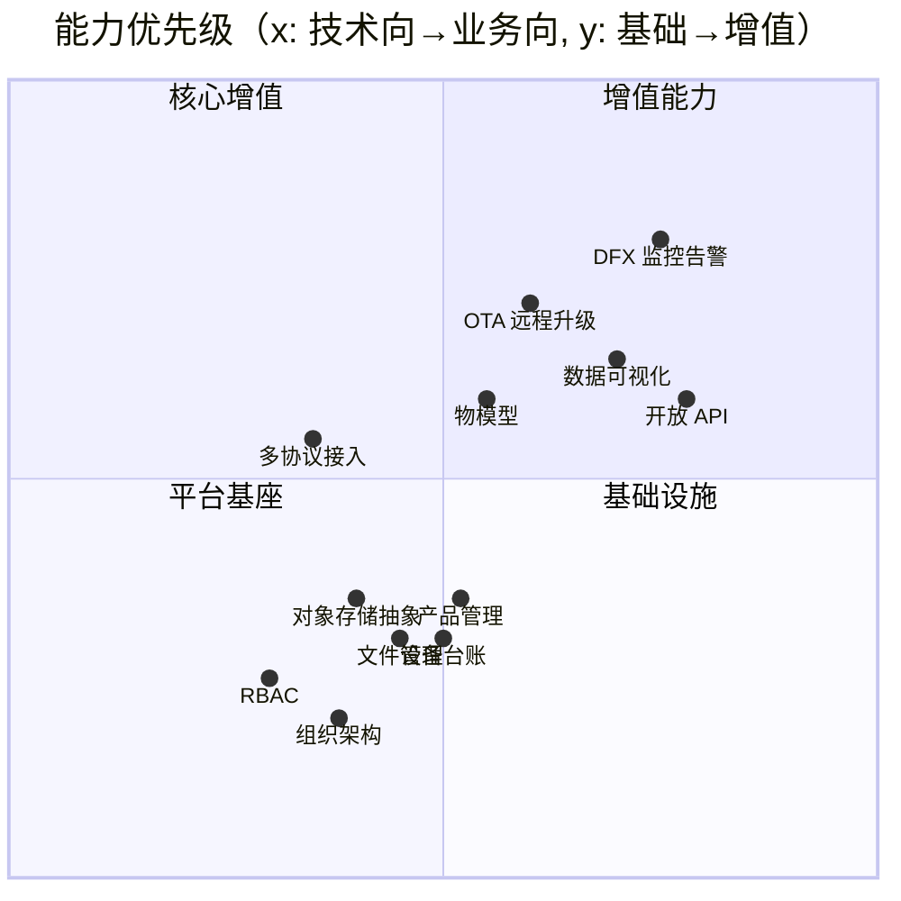
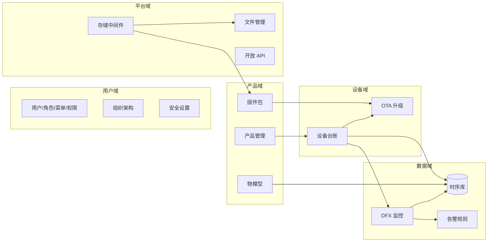

# Materin（格物）IoT 平台 · 产品与技术架构设计

> 版本 v1.0（2026-10-08）· 覆盖：产品设计 / 前后端技术架构 / 数据架构 / 部署架构
> 本文档与代码同步维护：后端 `backend/`，前端 `frontend/`，部署 `deploy/compose/`

## 目录

- [一、产品设计](#一产品设计)
- [二、总体技术架构](#二总体技术架构)
- [三、后端架构](#三后端架构)
- [四、前端架构](#四前端架构)
- [五、数据架构](#五数据架构)
- [六、部署架构](#六部署架构)
- [七、关键场景时序](#七关键场景时序)
- [八、演进路线](#八演进路线)

---

## 一、产品设计

### 1.1 产品定位

**格物（Materin）**：自建开源、可私有化部署的通用物联网平台。一个平台打通「设备接入 → 设备管理 → 数据沉淀 → 分析告警 → 远程运维」全链路，开箱即用、模块可裁剪。

设计参照 JetLinks（社区版）、ThingsBoard、阿里云 IoT 的公开能力面，按私有化场景裁剪。

### 1.2 目标用户与核心诉求

| 角色 | 核心诉求 | 平台入口 |
|---|---|---|
| 运营/管理员 | 租户内用户权限、系统参数、文件资产、开放接口授权 | 系统管理 / 开发者中心 |
| 产品经理 | 产品定义、物模型、接入协议、固件版本管理 | 产品管理 / 固件管理 |
| 设备运维 | 设备台账、在线状态、远程升级、故障定位 | 设备管理 / DFX 监控 |
| 数据分析 | 时序数据查询、指标可视化、告警追溯 | DFX 监控 |

### 1.3 产品能力全景



### 1.4 功能模块地图



### 1.5 前端页面地图（web-antd）

```mermaid
flowchart TD
    LOGIN[登录] --- DASH[工作台]
    DASH --- PRODUCT["产品管理<br/>标准/自定义产品"]
    DASH --- DEVICE["设备管理<br/>设备/固件管理/OTA"]
    DASH --- DFXM["DFX 监控<br/>指标/告警/SNMP 目标"]
    DASH --- DEV[开发者中心<br/>应用/API 授权]
    DASH --- SYS["系统管理<br/>用户/角色/菜单/组织/安全/文件"]
    DASH --- PROFILE[个人中心]
