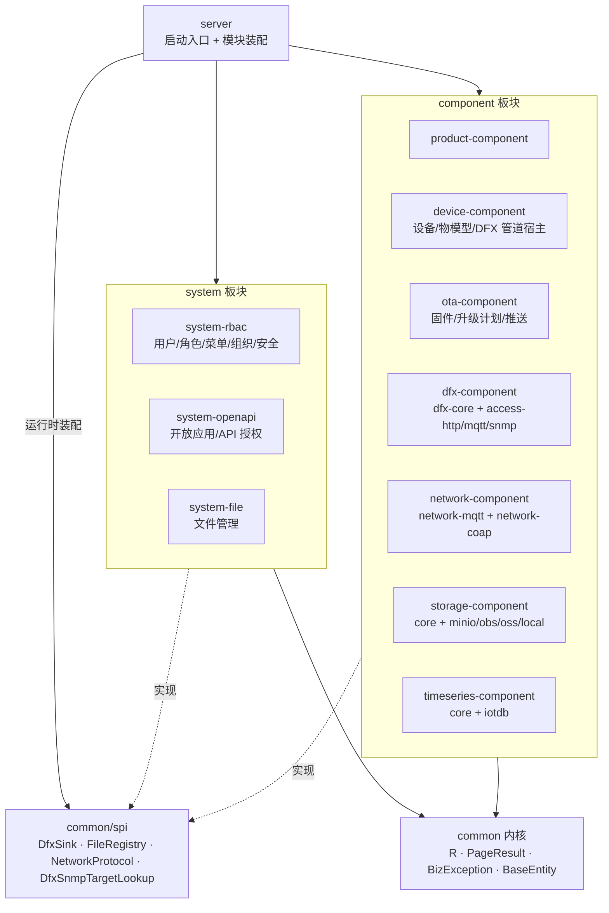
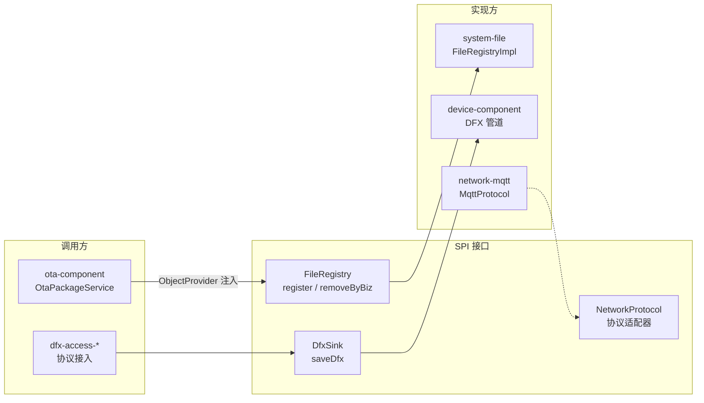

# 02 · 后端架构

## 1. Maven 模块依赖图



## 2. 模块职责清单

| 模块 | 职责 |
|---|---|
| common | 统一响应 R / PageResult / BizException / BaseEntity / SPI 接口 |
| system-rbac | JWT 登录（refresh 走 httpOnly cookie）、用户/角色/菜单/组织、菜单驱动动态路由 |
| system-openapi | 开放应用 AppKey/Secret、API 目录与授权 |
| system-file | `sys_file` 登记表 + list/download-url/delete + FileRegistry SPI 实现 |
| product-component | 产品 CRUD / 导入 / 状态 |
| device-component | 设备台账、生命周期、物模型 schema 校验、DFX 管道宿主（DfxIngestService） |
| ota-component | 固件经 StorageClient 落存储 + FileRegistry 登记、升级计划（产品/设备双圈选）状态机、MQTT 推送 |
| dfx-component | DFX 接入适配：dfx-core 管道 + http/mqtt/snmp 三接入 |
| network-component | NetworkProtocol SPI：MqttAuthController（EMQX webhook 鉴权/ACL）、协议注册表 |
| storage-component | 对象存储抽象：StorageClient 四实现 + 多存储器唯一性守卫 |
| timeseries-component | 时序抽象 + IoTDB 2.0 树模型实现 |

## 3. 板块内标准分层

```
module/
├── controller/   # REST + OpenAPI 注解，薄
├── service/      # 业务规则与守卫
├── entity/       # MyBatis-Flex @Table 实体（继承 BaseEntity）
├── mapper/       # BaseMapper 子接口
├── mqtt/         # （ota）下行推送
└── registry/     # （system-file）SPI 实现
```

## 4. SPI 协作全景



规则：
- 调用方一律 `ObjectProvider<T>` 注入，实现缺失时**功能降级不抛错**（上传链路照常，仅不登记）
- 实现方必须兜底异常，登记/指标失败只记日志
- SPI 契约在 `common/spi` 的 Javadoc 中写明兜底语义

## 5. 关键约束（评审清单）

1. 组件横向零依赖，协作只走 `common/spi`
2. storage / timeseries 家族：业务只 import core 抽象；实现子模块只被 server 装配
3. 分页统一 `PageResult{items,total}` —— mybatis-flex `Page` 直接返回会序列化成 `records/totalRow`，前端拿不到（已踩坑）
4. Flyway 迁移只增不改
5. mapper 扫描：`MaterinApplication` 显式 `MapperScannerConfigurer` 扫 `com.materin.tech` 全树（嵌套 jar 中 @Mapper 自动扫描覆盖不到，已踩坑）
6. 本地存储 LOCAL 模式的预签名 URL 指向后端自签端点 `/storage/local/**`，HMAC 验签
7. 证书头：新 Java 文件经 `mvn license:format` 补 MIT 头，`license:check` 可接 CI 校验
