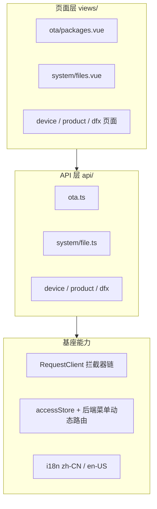
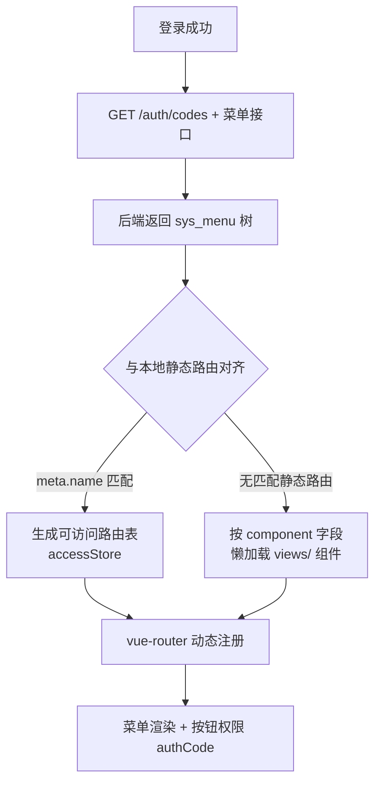

# 03 · 前端架构

## 1. 技术栈与工程结构

| 项 | 选型 |
|---|---|
| 框架 | Vue 3.5 + TypeScript |
| 基座 | Vben Admin v5（monorepo，仅保留 web-antd + backend-mock） |
| UI | Ant Design Vue 4.x |
| 状态 | Pinia（setup store） |
| 请求 | Axios 封装 RequestClient（拦截器链：token → 响应解包 → 401 刷新 → 错误提示） |
| 路由 | vue-router，**后端菜单驱动**（sys_menu 下发 + 本地静态路由兜底） |
| 构建 | Vite |

monorepo 根 = `frontend/`（已扁平化），dev:antd 端口 5666。

## 2. 分层图



## 3. 动态路由与菜单（前端 + 后端混合）

双轨制：本地静态路由（`router/routes/modules/*.ts`）保证开发可用，后端 `sys_menu` 保证运行期可配置。两者以 `meta.name` 对齐（如 `SystemFiles` ↔ sys_menu meta.name）。



示例（文件管理，本次新增）：
- 本地：`system.ts` 中 `path: 'files'`，`name: 'SystemFiles'`，组件 `views/system/files.vue`
- 后端：V12 迁移插入 `sys_menu(path='/system/files', component='system/files', meta.name='SystemFiles')`

## 4. 关键页面模式（以文件管理页为例）

```mermaid
flowchart TD
    P[files.vue onMounted load]
    P --> Q[query{page,bizType,keyword}]
    P --> T[表格渲染 items]
    P --> D[下载 = 先取预签名 URL 再 window.open]
    P --> X[删除 = Modal.confirm 二次确认<br/>业务来源文件给强提示]
    Q -->|GET /file/list| BE
    D -->|GET /file/{id}/download-url| BE
```

## 5. 约定与约束

1. 新页面三件套：`api/system/xxx.ts` + `views/.../xxx.vue` + 路由（system.ts）+ sys_menu 种子（V-next 迴移）
2. `$t('system.files.title')` 需同时补 zh-CN / en-US 两份 locale
3. MIT 证书头（与后端一致）
4. 分页消费 `{items, total}` 信封
5. 请求头自动携带 `Authorization: Bearer`，401 走 refresh cookie 静默续期
