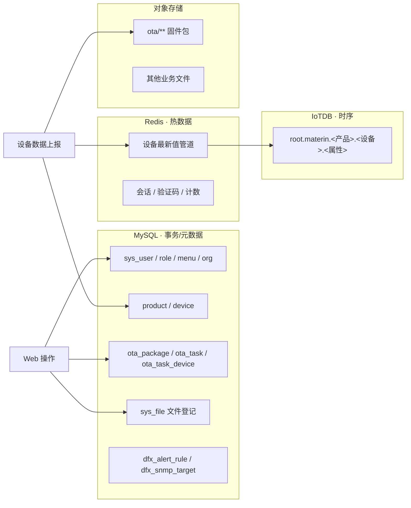
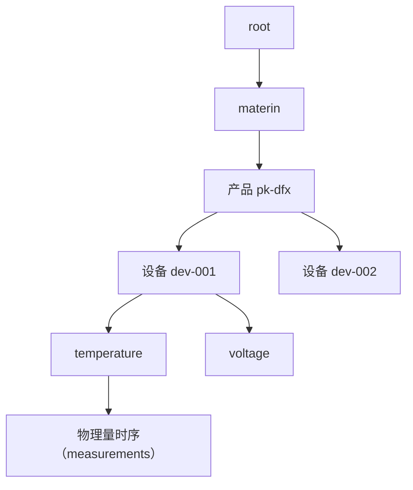
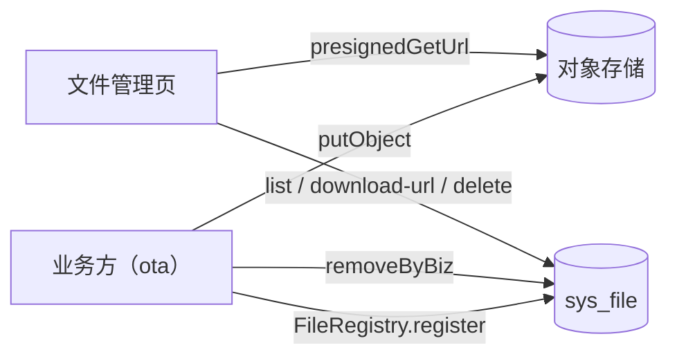

# 04 · 数据架构

## 1. 四类数据的归属

| 数据类型 | 存储 | 理由 |
|---|---|---|
| 元数据（产品/设备/任务/权限） | MySQL + Flyway | 强一致、事务、关系查询 |
| 遥测时序 | IoTDB 树模型 | 压缩率高、按设备层级组织、降采样查询 |
| 最新值/在线状态 | Redis | 管道实时读写，避免时序库热写压力 |
| 文件（固件/附件） | StorageClient 抽象 | MinIO/OBS/OSS/本地四实现，元数据只在 MySQL |

## 2. MySQL schema 管理

- Flyway 版本化迁移：`V1__init_schema.sql` … `V12__sys_file.sql`
- 铁律：**历史迁移文件不可变**，schema 变更只新增 `V<n>__*.sql`
- 审计字段统一由 `BaseEntity`（id/create_time/update_time）承担，DB 默认值 `now()`

## 3. IoTDB 树模型组织

- 写入：`insertTablet` 批量写，属性列由产品物模型（ProductSchema）定义
- 查询：IotdbQueryBuilder 生成聚合/降采样 SQL（avg/max/min + interval）
- 建库/建时序：懒创建（首次写入自动补齐路径）

## 4. 文件登记（sys_file）

约束：对象存储只存文件实体，`sys_file` 只存元数据（bucket/key/size/bizType/bizRefId）；删除语义 = 先删对象再删登记，对象删除失败仍删登记（与固件包删除一致）。
