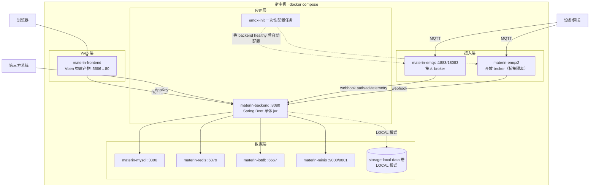
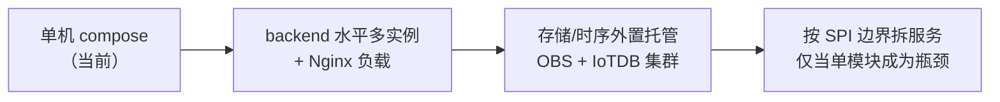

# 05 · 部署架构

## 1. Compose 部署拓扑（单机私有化默认形态）

服务清单（`deploy/compose/docker-compose.yml`，9 服务 7 卷）：

| 服务 | 镜像 | 端口 | 说明 |
|---|---|---|---|
| backend | 自建（Dockerfile.backend） | 8080 | 全部业务逻辑，Flyway 启动迁移 |
| frontend | 自建 | 5666 | Vben 静态产物 |
| mysql | mysql:8 | 3306 | 元数据 |
| redis | redis | 6379 | 热数据 |
| iotdb | iotdb 2.0 | 6667 | 时序 |
| emqx | emqx 5.x | 1883/18083 | 接入 broker |
| emqx2 | emqx 5.x | — | 开放 broker，与接入隔离 |
| emqx-init | 自建 | — | 等全部 healthy 后写 EMQX 配置（webhook/桥接/ACL） |
| minio | minio | 9000/9001 | 对象存储（或切 LOCAL 本地卷） |

## 2. 关键链路配置

- **MQTT 鉴权**：EMQX `EMQX_AUTHENTICATION__1__URL = http://backend:8080/api/v1/mqtt/auth`（webhook → MqttAuthController → MqttAccessPolicy）
- **ACL**：`AUTHORIZATION__SOURCES__1__URL` 同上，设备只能 publish/subscribe 自己主题
- **双 broker 隔离**：emqx2 为开放 broker，独立鉴权，通过桥接把数据汇入主链路，凭证不互通
- **存储模式切换**：`MATERIN_STORAGE_TYPE` = MINIO（默认）/ OBS / OSS / LOCAL；LOCAL 模式挂 `storage-local-data` 卷，预签名 URL 走后端自签端点
- **健康检查**：backend healthcheck `curl /api/v1/device/list`，emqx-init 等 `service_healthy` 再执行

## 3. 环境变量（backend 注入）

| 变量 | 作用 |
|---|---|
| MYSQL_HOST/PORT/DB/USER/PASSWORD | 数据源 |
| REDIS_HOST/PORT | 缓存 |
| MATERIN_IOTDB_HOST/PORT | 时序 |
| MATERIN_NETWORK_MQTT_HOST/PORT | 下行 MQTT |
| MATERIN_MQTT_SERVICE_PASSWORD | 平台 MQTT 服务账号 |
| MATERIN_STORAGE_TYPE | 存储实现选择 |
| MATERIN_STORAGE_ENDPOINT | 后端容器内访问存储 |
| MATERIN_STORAGE_EXTERNAL_ENDPOINT | **浏览器侧**下载 URL 的 host（OrbStack 宿主机建议 `http://localhost:9000`） |
| MATERIN_STORAGE_BUCKET / ACCESS_KEY / SECRET_KEY | 凭证 |
| JDK_JAVA_OPTIONS | JVM 内存（默认 -Xms256m -Xmx512m） |

## 4. 已知环境坑与规避

| 坑 | 规避 |
|---|---|
| Docker Hub 不可达 | compose 走镜像源；本机 Testcontainers 不可用（容器集成测试跑不了，单元测试全绿即可合入） |
| OrbStack 宿主机不解析 host.docker.internal | 预签名下载 host 用 `.env` 显式指定 localhost |
| 嵌套 jar 内 @Mapper 扫不到 | server 显式 MapperScannerConfigurer（已在代码固化） |

## 5. 扩容与演进路径

- 拆分原则：只有当某 component 板块（如接入层）成为独立伸缩需求时，才沿 `common/spi` 边界抽出，绝不按技术分层拆
- 前端可独立 CDN 化：产物为纯静态
