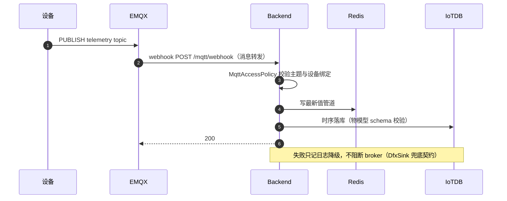
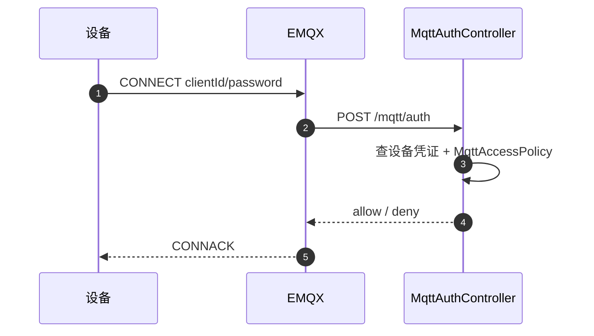
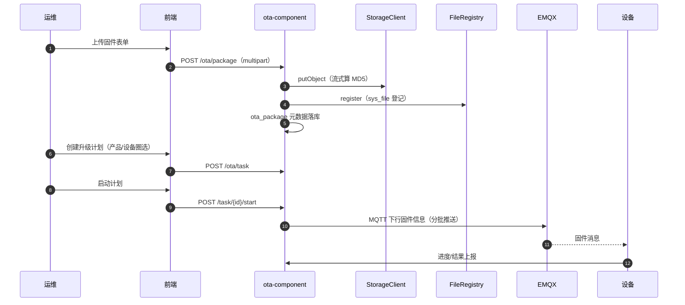
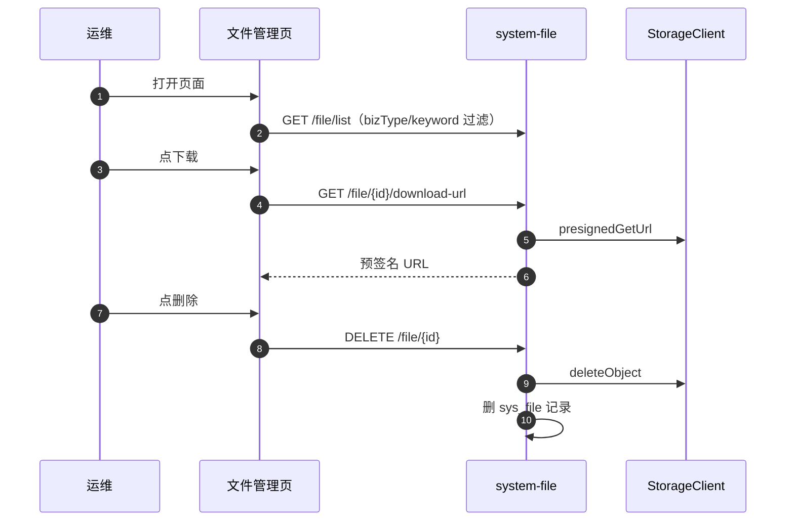
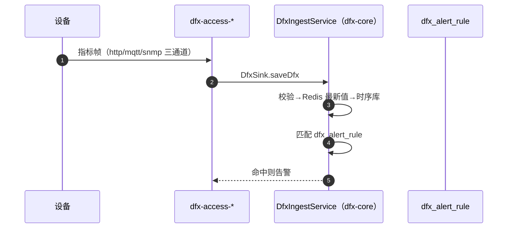
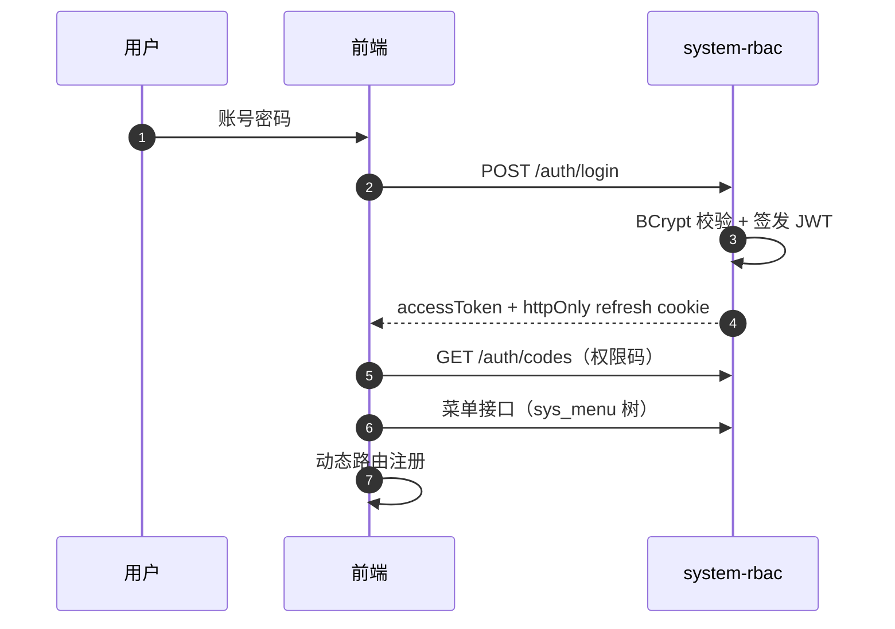

# 06 · 关键场景时序

## 1. 设备遥测上报 → 入库（MQTT webhook 链路）

## 2. MQTT 连接鉴权（EMQX webhook）

## 3. OTA 固件上传 → 升级推送

场景 3 的两个设计要点：
- 升级计划创建只登记口径，不展开设备，设备通过详情分页添加，避免大产品全量展开 OOM（已修复的历史问题）
- 固件删除联动清 sys_file 登记

## 4. 文件管理（本次新增能力）

## 5. DFX 告警链路

## 6. 登录与权限

