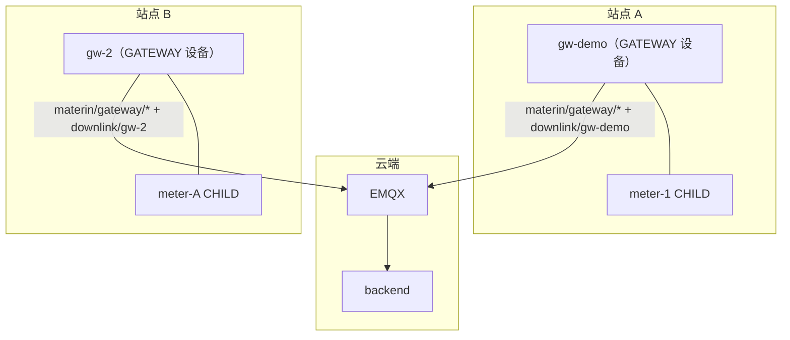

# 07 · 边缘网关（Materin Gateway）

> 对齐 ThingsBoard IoT Gateway：独立 Spring Boot 程序（gateway/，与 backend 平级），
> 以一台 GATEWAY 设备身份经 MQTT 接入平台，代理子设备统一接入。
> 平台侧（backend）与边缘侧（gateway）职责分离，经 gateway 主题族协议解耦。

## 1. 概念模型

```mermaid
flowchart TB
    subgraph Platform["materin-iot 平台"]
        EMQX["EMQX broker"]
        BE["backend 单体"]
    end
    subgraph Edge["边缘网关（独立进程）"]
        GW["materin-gateway"]
        C1["Connector: MQTT Bridge"]
        C2["Connector: Modbus TCP"]
        C3["Connector: 自定义"]
    end
    subgraph Field["现场设备"]
        S1["子设备 A"]
        S2["子设备 B"]
    end
    C1 --> S1
    C2 --> S2
    GW -->|"materin/gateway/# 协议"| EMQX
    EMQX --> BE

GW 是 GATEWAY 设备：平台创建设备时选类型 GATEWAY，拿到 deviceKey/secret 配进网关。
子设备（CHILD）由网关 connect 声明自动注册，归属网关，继承网关产品。

## 2. 平台侧改造（backend）

| 改动 | 说明 |
|---|---|
| V13 迁移 | device 表加 device_type（DIRECT/GATEWAY/CHILD）、gateway_id、idx_device_gateway |
| GatewayHandler（network-mqtt） | 消费 materin/gateway/#：connect=自动注册+在线、disconnect=离线、telemetry=复用遥测管道、attributes=最新值 |
| GatewayChildRegistry SPI | common/spi 新增，device-component 实现（自动注册 CHILD/归属绑定/离线） |
| ACL（MqttAccessPolicy） | 仅 GATEWAY 设备可发布 gateway 主题族；GATEWAY 可代子设备发 reply |
| CHILD 命令路由 | DeviceCommandService：CHILD 下发改走 materin/gateway/downlink（payload 带 replyTopic），网关代子设备回执 |

## 3. 网关协议（主题族与 payload）

| 主题 | 方向 | payload |
|---|---|---|
| materin/gateway/connect | 网关→平台 | {"gateway":"gw","device":"dk","name":".."} |
| materin/gateway/disconnect | 网关→平台 | {"gateway":"gw","device":"dk"} |
| materin/gateway/telemetry | 网关→平台 | {"gateway":"gw","<dk>":[{"ts":ms,"values":{..}}]} |
| materin/gateway/attributes | 网关→平台 | {"gateway":"gw","<dk>":{..}} |
| materin/gateway/downlink | 平台→网关 | {"device":"dk","requestId":"..","data":{..},"replyTopic":"materin/{pk}/{dk}/reply"} |

**网关自身数据约定**：网关遥测/属性也经 gateway 主题族上报（payload 中 deviceKey 用网关自己的 deviceKey，
即 `{"gateway":"gw","gw":[{...}]}`）。平台 GatewayHandler 识别 childKey == 网关自身时走"网关自身数据管道"
（写最新值/时序，**绝不注册成子设备**）——该守卫有专门单测覆盖。

**多网关**：每台网关以各自 GATEWAY 设备凭证接入，下行主题 `materin/gateway/downlink/{gatewayDeviceKey}`
按网关物理隔离（ACL 只允许订阅自己的下行），子设备归属各自的网关，命令经"对应网关"下发。

对照 ThingsBoard：connect/disconnect/telemetry/attributes/rpc 语义一致，主题前缀换成平台统一的 materin/ 前缀，
身份模型简化（payload 自带 gateway 字段，ACL 已校验发布者是网关）。

## 4. Connector 框架

```mermaid
flowchart LR
    subgraph GW["materin-gateway 进程"]
        GS["GatewayService<br/>（SmartLifecycle）"]
        PMQ["PlatformMqttClient"]
        REG["ConnectorRegistry"]
        subgraph Connectors
            DEMO["DemoConnector<br/>调试模拟"]
            BRIDGE["MqttBridgeConnector<br/>局域网子 broker 桥接"]
            MODBUS["ModbusConnector<br/>（规划）"]
        end
    end
    GS -->|"实现 ConnectorContext"| Connectors
    Connectors --> REG
    GS --- PMQ
    PMQ -->|"connect/disconnect/telemetry/attributes"| EMQX2(("EMQX"))
    EMQX2 -->|"downlink"| GS

## 5. 数据流（端到端）

```mermaid
sequenceDiagram
    autonumber
    participant S as 子设备
    participant C as Connector
    participant G as materin-gateway
    participant E as EMQX
    participant B as backend
    S->>C: 现场数据
    C->>G: ctx.connect/telemetry
    G->>E: materin/gateway/telemetry
    E->>B: 共享订阅消费（服务账号）
    B->>B: GatewayHandler → 自动注册 CHILD → Redis 最新值 + TelemetrySink
    B-->>G: downlink（平台下发子设备命令）
    G->>C: connector.onCommand
    C->>S: 现场写操作
    C->>G: ctx.reply
    G->>E: publish replyTopic
```

## 6. 快速开始

1. 平台创建产品与 GATEWAY 设备（如 gw-demo），取 deviceKey/secret
2. gateway/src/main/resources/application.yml 填 platform.host/port/deviceKey/secret
3. 启动：`cd gateway && mvn spring-boot:run`（或 java -jar target/materin-gateway-0.1.0-SNAPSHOT.jar）
4. 平台设备列表可见子设备自动注册（CHILD，归属 gw-demo），遥测入库

## 7. 部署形态

- 独立 JVM 进程，最低 256MB 内存，可跑在边缘盒子/工控机/旁路服务器
- gateway/Dockerfile：eclipse-temurin:21-jre 精简镜像，与平台 compose 独立编排
- 多协议扩展：实现 Connector 接口即可接入（Modbus/OPC-UA/BACnet 等 connector 规划中）

## 8. 与 ThingsBoard Gateway 能力对照

| 能力 | TB Gateway | Materin Gateway |
|---|---|---|
| 独立进程部署 | 是 | 是（独立 Spring Boot 程序） |
| 以设备身份接平台 | MQTT v1/gateway/* | MQTT materin/gateway/*（语义对齐） |
| 子设备自动注册 | 是 | 是（CHILD 自动注册+归属绑定） |
| 子设备上下线 | connect/disconnect | 一致 |
| 子设备遥测/属性 | v1/gateway/telemetry 等 | 一致 |
| RPC 到子设备 | v1/gateway/rpc | materin/gateway/downlink + replyTopic 回执 |
| Connector 框架 | 20+ connector | 配置驱动 connector：mqtt-bridge / modbus-tcp / opcua / demo（调试）；自定义协议实现 Connector 接口扩展 |
| 配置热更新 | 是 | 本地 application.yml 配置驱动（平台下发 connector 配置为规划项） |

## 9. 配置驱动协议接入（对齐 TB 的 connector 配置化）

TB Gateway 的核心体验：Modbus / OPC-UA 等现场协议只填配置、不改代码。本网关同样以配置驱动：

```yaml
materin:
  gateway:
    connectors:
      - type: modbus-tcp          # Modbus TCP 轮询
        id: shop-floor-1
        slaves:
          - host: 192.168.1.50    # PLC/网关地址
            port: 502
            unitId: 1
            pollPeriodMs: 5000
            registers:
              - { name: temperature, address: 0, functionCode: readHoldingRegisters, dataType: float32 }
              - { name: pressure, address: 2, functionCode: readInputRegisters, dataType: int16, scale: 0.1 }
      - type: opcua               # OPC-UA 节点订阅
        id: scada-1
        endpointUrl: opc.tcp://192.168.1.60:4840
        securityPolicy: None
        nodes:
          - { nodeId: ns=2;s=Motor1.Speed, name: motor_speed }
      - type: mqtt-bridge         # 局域网 MQTT 子设备桥接
        id: sub-broker
        broker: tcp://192.168.1.70:1883
        mappings:
          - topic: site1/+/data
            deviceIndex: 1
```

约定：所有 connector 通过 type + 参数化配置实例化；遥测键 = 寄存器/节点映射的 name；
命令下行同理反向映射（name → 寄存器写 / OPC UA writeValue / 子 broker publish）。

## 10. 产品形态体系（产品 → 物模型 → 设备）

所有设备遵循 产品 → 物模型 → 设备 链路，产品定义节点形态（V14 `product.node_type`）：

| 产品形态 | 其下设备 | 创建路径 |
|---|---|---|
| DIRECT 直连产品 | 直连设备（device_type=DIRECT） | 手工创建 / 批量导入 |
| GATEWAY 网关产品 | 网关设备（device_type=GATEWAY） | 手工创建 / 批量导入 |
| CHILD 子设备产品 | 子设备（device_type=CHILD，必须挂网关） | 网关详情添加 / 批量导入 / 网关自动注册（connect 声明可选 productKey） |

约束（DeviceService 强制）：设备类型必须匹配产品形态；设备必须归属有效产品；
CHILD 必须指定有效网关。导入（批量）与手工创建走同一校验链路。

## 11. 多网关拓扑



下行命令按"子设备 → 归属网关 → 该网关专属 downlink 主题"路由，多网关互不串扰。
